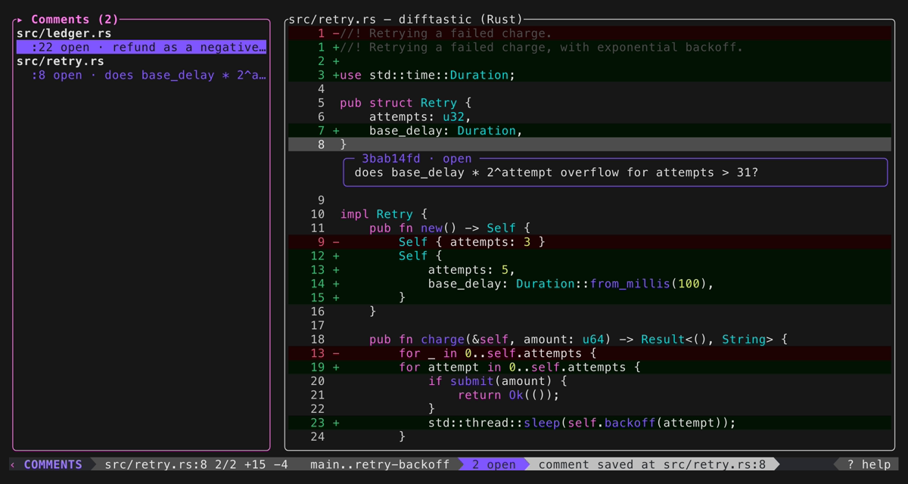

# rv

**Review code on your disk, not on a forge.** A terminal reviewer for
[Jujutsu](https://jj-vcs.github.io/jj/) stacks — structural diffs, inline
comments, and a CLI that makes the same review a coding agent's task list.


`rv` reads a range of jj changes out of your local repository, shows you the
diff — [difftastic](https://difftastic.wilfred.me.uk/)'s language-aware
structural diff, syntax-highlighted, with full-file context — and lets you
attach comments to individual lines. Those comments live in `.review/`,
anchored to content rather than line numbers, so they survive rebases and
amends.

The same CLI is a coding agent's whole interface to the review: the agent
reads it with `rv comments --json`, fixes the code, answers with `rv reply`,
and ticks work off with `rv resolve` — no file parsing anywhere, and
`rv status --check` is the poll loop. You review in one pane; the agent
works through your findings in another; `rv` refreshes itself as the
commits land.

It is a review tool for the work sitting on your disk right now — before it
becomes a pull request, or instead of ever becoming one.

- **Structural diffs** — difftastic under the hood, with an honest
  line-diff fallback that names itself in the status bar
- **Comments that survive history rewrites** — content-anchored, with a
  three-tier re-anchoring cascade before a comment is ever marked outdated
- **A review per branch** — `rv feature-a` and `rv feature-b` are
  independent sessions; jump between them and each is where you left it
- **Auto-refresh** — the reviewer watches jj's operation log and the files
  under review, and follows commits, rebases, checkouts and plain edits as
  they happen — comments moving with the code they are about
- **An agent loop with no glue code** — JSON out, replies and resolutions
  in, one exit code to poll
- **Configurable** — remap any key in `keybindings.toml`, set your session
  defaults in `Config.toml`, or use it stock with zero setup
- **No forge, no network, no accounts** — it never leaves your machine, unless
  you configure an agent CLI for it to run ([Asking an agent](#asking-an-agent))

## What rv is not

- **No forge.** It does not know what GitHub, GitLab, Gerrit or Forgejo are. It
  never reads or writes a pull request, a merge request or a change list.
- **No network.** Nothing `rv` does makes an outbound connection. An `[agent]`
  command you configure is a separate program, and it may.
- **No authentication.** There is no account, no token, no config file to hold
  one.
- **No model calls of its own.** `rv` holds no API key, no URL and no provider
  code, and never talks to an LLM itself. The handoff is a file you give to
  whatever agent you already use — or, if you configure one, a command `rv` runs
  for you: the prompt on its stdin, the answer read back from its stdout, the
  same shape as shelling out to difftastic. Off by default; see
  [Asking an agent](#asking-an-agent).
- **No history mutation.** `rv` opens the repository read-only. It never starts
  a transaction and never writes inside `.jj/`. The only things it writes are
  `.review/` and one line appended to `.git/info/exclude` — unless you turn on
  [language servers](#language-servers), which write their own caches.
- **No jj-config coupling.** `rv` deliberately ignores your jj config — your
  `revset-aliases`, your `ui.diff.tool`, all of it. It behaves the same on a
  fresh jj install as on a heavily customised one. Its own configuration
  lives in `~/.config/rv/` and every bit of it is optional.

## Requirements

- A jj repository **colocated with git** — one with a top-level `.git/`. This is
  the default for `jj git init` as of jj 0.44. `rv` needs `.git/info/exclude` to
  keep `.review/` out of the change you are reviewing; see
  [Current limits](#current-limits) for what happens without it.
- Rust 1.89 or newer, edition 2024 (both forced by `jj-lib` 0.44) — to build
  from source. The prebuilt binaries below need none of it.
- [difftastic](https://difftastic.wilfred.me.uk/) (`difft`) on `PATH`, optional.
  With it you get structural, language-aware diffs. Without it `rv` silently
  falls back to a line diff and labels the pane `fallback` so you always know
  which one you are reading.

## Install

```sh
# macOS and Linux
curl --proto '=https' --tlsv1.2 -LsSf https://github.com/Firaenix/rv/releases/latest/download/rv-installer.sh | sh

# Windows
powershell -c "irm https://github.com/Firaenix/rv/releases/latest/download/rv-installer.ps1 | iex"

# Homebrew
brew install Firaenix/tap/rv
```

Prebuilt binaries are published for macOS (Apple Silicon and Intel), Linux
(x86-64 and arm64) and Windows (x86-64). Each release also carries the archives
and their checksums directly, if you would rather not pipe a script into a
shell.

### From source

```sh
cargo build --release        # ./target/release/rv
cargo install --path rv      # or put it on your PATH
```

`rv` is not on crates.io: the name belongs to an unrelated project there, so
`cargo install rv` installs something else. Install from this repository, or
use one of the binaries above.

## Usage

Run `rv` from the **workspace root** — the directory holding `.jj/`. See
[Current limits](#current-limits).

| Command | What it reviews |
| --- | --- |
| `rv` | `trunk()..@` — everything on your stack that trunk does not have |
| `rv <bookmark>` | `trunk()..<bookmark>`. The target may be a bookmark, a change id or a commit id |
| `rv --from <rev> --to <rev>` | An explicit range, e.g. `rv --from main --to my-feature` |
| `rv browse [<path>] [--to <rev>]` | The code as it stands at `@` (or `<rev>`), every file whole — see [Browsing the tree](#browsing-the-tree) |
| `rv comment <file> --line <n> [--side left] -m <text>` | Adds a comment exactly as the TUI would — anchor and id handled. `-m -` reads the body from stdin. The reviewer agent's way in |
| `rv comments [--json] [--state open]` | Lists the comments — id, state, body, reply, anchor and excerpt. The agent's read channel |
| `rv reply <id> -m <text>` | Stores an answer on the comment (`-m -` for stdin). A second reply replaces the first; state is untouched |
| `rv resolve <id>` / `rv abandon <id>` | Settles a comment, recording who (`--by agent` is the default; the TUI's `R` and `c a` record `user`). Re-applying reopens it |
| `rv diff [<file>] --json` | The changes in rv's own side-aware coordinates — the numbers `rv comment --line` accepts |
| `rv render [--out <path>]` | Prints the review as markdown, a view nothing reads back; `--out` writes it to a file |
| `rv brief [--json] [--out <path>] [--context <n>]` | The handoff bundle: every unsettled comment, grouped by file, with its anchor's confidence, the code around it as it stands now (`--context` lines either side, default 5) and the commands that answer it. See [Handing off with `rv brief`](#handing-off-with-rv-brief) |
| `rv brief --ask [--context <n>]` | Pipes the brief through the agent configured under `[agent]`, prints its answer (with duration and cost when reported), and files the lines it points at as flags by `agent`. The one query that writes — see [Asking an agent](#asking-an-agent) |
| `rv status` | Prints the range, its changes, its changed files and its comment counts |
| `rv status --json` | The same report as JSON, for scripting |
| `rv status --check` | Exit 1 while any comment is open, 0 otherwise, nothing printed — the worker's poll and a CI gate |
| `rv flag <file> --line <n> [--side left] -m <reason>` | Points the reviewer at a line with a reason — attention, not feedback. Never blocks `--check`. The agent's way to say "start here" |
| `rv flags [--json] [--open]` | Lists the flags — id, state, anchor, reason |
| `rv ack <id>` / `rv unflag <id>` | Marks a flag looked at, or removes it |
| `rv review <file> [--change <id>]` / `rv unreview …` | Ticks a file off as reviewed — the range's diff of it, or one change's — or clears the tick |
| `rv reviewed [--json]` | Lists the ticked files, and which have changed since |
| `rv completions <shell>` | Prints the completion script for `bash`, `zsh`, `fish`, `elvish` or `powershell` on stdout. The nix and Homebrew packages install it for you |
| `rv --repo <path> …` | Reviews the workspace at `<path>` instead of the current directory |
| `rv --tree …` | Runs any subcommand against the tree review `rv browse` opens instead of the range review, e.g. `rv --tree comments --json` |
| `rv --no-agent …` | Runs no agent this time, whatever `[agent]` says |
| `rv --no-difft …` | Diffs with the in-process engine instead of difftastic: line-based rather than structural, with context lines. What a reviewer with no `difft` on `PATH` sees |

### Nix

```sh
nix run .            # run rv without installing anything
nix build            # ./result/bin/rv, with difftastic wrapped onto its PATH
nix develop          # a shell with cargo, jj, difftastic and the rust toolchain
```

The packaged binary carries its own difftastic, so structural diffs work even
where `difft` is not installed, and its shell completions are installed beside
it — nothing to source.

A `cargo install` carries neither, so completions are a command there:

```sh
rv completions zsh > "${fpath[1]}/_rv"
rv completions bash > /etc/bash_completion.d/rv
rv completions fish > ~/.config/fish/completions/rv.fish
```

`--to` overrides the positional target when both are given. That is also the
escape hatch for the one name collision: a bookmark literally called `render` or
`status` has to be passed as `rv --to status`, since subcommands share the first
positional slot.

`rv`'s idea of `trunk()` is its own built-in one — the latest of
`main`/`master`/`trunk` on `origin`/`upstream`, falling back to the repository
root. It is not read from your config, so in a repository with no remotes the
default range is your entire history.

Exit codes: **0** on success (including `--help` and `--version`), **1** when
`rv` itself fails — an unreadable workspace, an unresolvable revision, an empty
range, no terminal — and **2** for a command line clap rejects, such as an
unknown flag. Failures print the whole error chain as a sentence rather than a
backtrace.

### Example

Real output from `rv` reviewing its own repository, with the middle of each list
elided at the `…` markers:

```
$ rv status
revset  trunk()..@
base    0000000000000000000000000000000000000000
head    2b9795343e3de90321d23e92e13c8efb6a30e613

changes (17)
  ntoxqqukosxynuuymkrsllvymmsnsmxp 2b9795343e3de90321d23e92e13c8efb6a30e613 (no description set)
  uspywkpvwqtypzsqrwmptwpymlvvrtok fbad2ee3477848ec4350606e4961374f8bd24bb5 docs(rv): README and milestone-1 dogfood verification
  mspsnktlqkkmpyyqunnolnwqnnuvwkuv c960123dbb78d6cec5c61e0406fe66ce0301efad fix(rv): widen comment ids and display the anchored line number
  …
  nowwnlnmvkwonnvtrspxrrxnprsupkvs 38c8c68bf0bd9f88aa93cacce4dbd9512a670df0 docs: rv design spec, milestone-1 implementation plan, and handoff

files (28)
  added     Cargo.lock
  added     Cargo.toml
  added     README.md
  …
  added     rv/tests/cli.rs

comments  0 open, 0 awaiting verification, 0 resolved, 0 abandoned, 0 outdated
```

Every file reads `added` there only because this repository's whole history is
one stack with no merge base — `trunk()` degrades to the root commit when there
are no remotes. In a normal repository you will see `modified`, `removed` and
`renamed` too.

Change ids are shown the way `jj log` shows them (the reverse-hex `z`–`k`
alphabet), so you can paste one straight back into a jj command.

## The reviewer

A bare `rv` opens the terminal UI: a sidebar and a diff pane over a status
line, with your comments drawn in the diff itself, under the lines they are
about.

```
┌──────────────────────┬──────────────────────────────────────────────────────┐
│ Files (27)           │ ▸ rv-core/src/anchor.rs — difftastic (Rust)          │
│ +  Cargo.lock        │    47 +    let start = index.satu…                   │
│ +  rv-core/src/an…   │    48 +    let end = (index + 5)…                    │
│ ~  rv/src/ui.rs      │        ╭─ 8d985355 · open ────────────────╮          │
│                      │        │ lines.len() - 1 underflows       │          │
│                      │        │ reply: fixed with unwrap_or(0)   │          │
│                      │        ╰──────────────────────────────────╯          │
├──────────────────────┴──────────────────────────────────────────────────────┤
│ ↓↑ move  ←→ focus  [/] file  c comment  g goto  v view  ? help  q quit │
└─────────────────────────────────────────────────────────────────────────────┘
```

The sidebar marks each file by how it changed: `+` added, `-` removed, `~`
modified, `->` renamed. `Tab` switches it from that file list to a list of every
comment in the review, and `Enter` on one of those rows opens the code it is
about. The diff pane's title says where its lines came from — `difftastic
(Rust)`, `fallback`, or `binary` — so a degraded diff is never mistaken for a
structural one. Diffs are computed lazily, for the selected file only, and
cached, so stepping back to a file does not re-run difftastic.

The pane the next keystroke lands in is marked with a `▸` on its title and a
bold border, never with colour — the chrome's colours already mean something
else: a blue border is a *comment*, a green background an *addition*, a red one
a *removal*.

**The code's own colours are your terminal's, not `rv`'s.** Syntax highlighting
emits only the 16 indexed ANSI colours, which every scheme redefines for itself,
so `rv` shows your Solarized or your Gruvbox rather than a palette it picked —
which is why there is no theme setting and no need for one. The chrome and the
code never collide because they use different channels: a diff's green and red
are *backgrounds*, and a syntax colour is always a *foreground*.

### Keybindings

Every key below is the default, and almost all of them can be remapped in
`~/.config/rv/keybindings.toml` — a *patch* over the defaults, where
`command = "key"` moves a command onto a new key and frees its old one:

```toml
[leaders]
goto = "g"                 # which key opens each leader's menu

[keys]                     # direct keys, everywhere
cursor_next_row = ["j", "Down"]
app_quit = "Q"

[keys.files]               # direct keys in one pane only
diff_toggle_full_context = "f"

[goto.diff]                # a leader's children, scoped to one pane
cursor_last_row = "e"
```

`rv keymap` opens the file in `$EDITOR`, seeding it with the fully-commented
defaults on first run — which is also where the command vocabulary lives —
and validates it the moment the editor exits; `rv keymap --show` prints the
*effective* map, defaults and patch merged. A user bind that lands on a key a
default already holds simply takes it, and the review says so when it opens;
only a config that contradicts *itself* refuses to load. `Ctrl+C`,
`Shift`+arrows and the `?` popup's own keys are not remappable.

Session defaults — the display preferences you would otherwise re-toggle at
the top of every review — live in `~/.config/rv/Config.toml` (`rv config`
opens it, seeded and validated the same way), every field optional:

```toml
tree = true            # open the file list as a tree
sort = "added"         # natural | added | removed
full_context = false   # open on changes-only
grouped = true         # removals before additions in each hunk
tint = false           # no proportion tint on sidebar rows
counts = false         # no +n -n column
wrap_commit_subjects = true  # wrap commit rows instead of clipping them
sidebar_hidden = true  # open with the sidebar put away
split = 40             # sidebar share of the width, in percent
ascii = true           # ASCII status-bar separators (RV_ASCII as a setting)
engine = "fallback"    # auto | fallback — --no-difft as a default
auto_refresh = false   # stop refreshing when the repo or a reviewed file moves (on by default)
hover = true           # open g i's card when the pointer rests on a name (off by default)
provenance = true      # open with the v p provenance gutter on (off by default)
```

`hover = true` depends on the terminal reporting pointer motion, which not all
do; `g` `i` is the same card from the keyboard.

### Browsing the tree

`rv browse` reviews the repository as it is rather than a range: the sidebar
lists every file in the tree at `@` (or `--to <rev>`), and each opens whole,
every line context. `rv browse src/` lists only what is under `src/`. Files
are read when opened, not at launch, so a large tree opens at once.

Comments, flags and reviewed ticks work as they do in a range — anchors follow
the code as it is edited — and live in a review of their own, `@tree`
(`@tree-<rev>` for another revision), which never mixes with the range review
of the same head. The subcommands reach it with `--tree`:

```sh
rv --tree comment src/lib.rs --line 12 -m "why is this public?"
rv --tree comments --json
rv --tree status --check
```

In the sidebar a file's mark is `·` and its count is its size on disk; `v o`
cycles between `path` and `size` order (`sort = "path"` or `"size"` in
`Config.toml`).

### Line provenance

`v` `p` puts a gutter ahead of the line numbers naming, by the first eight
characters of its change id, the change that last touched each line of the
head side. A run of lines from one change is named once, on its first line;
changes this review covers are bright and older ones dim. Removed lines have
no head-side origin and stay blank. `i` on a line opens a card with the
change's id, author, date and the first line of its description.

The annotation walks the file's history with jj, so it runs in the background:
the gutter shows `…` until it lands, and nothing waits on it. It is computed
once per file and head commit, and works the same in `rv browse` and in a
range review.

### Several reviews at once

Every reviewed head gets its own directory under `.review/reviews/`, so
reviews never clobber each other: `rv feature-a` and `rv feature-b` are two
independent sessions — comments, scope and export each — and jumping back to
either finds it exactly where it was left. A bare `rv` is the one ambient
`working-copy` review that follows `@` wherever you take it. `rv reviews`
lists everything stored, with each review's range and comment counts.

While the TUI is open, rv watches jj's operation log **and the working copy of
the files under review** (a handful of stat calls every two seconds) and
refreshes itself when either moves — an agent's commit landing, a rebase, a
file saved in an editor — and again the moment the terminal regains focus, so
what you come back to is what is there now. It never interrupts a comment being
typed or a confirmation being answered.

**Browsing**

Movement is the **arrows** (and the mouse); in the diff `←`/`→` step a column
cursor along the selected line a character at a time and `h`/`l` step it a word
at a time, clicking a character places it there, and the line scrolls sideways
to keep the cursor on screen. **Uppercase acts, lowercase moves**: every key that
writes to the review or leaves the reviewer is a shifted letter — `C` comment,
`D` delete, `R` resolve, `A` acknowledge a flag, `F` flag, `X` tick reviewed,
`E` edit — so a mutation is always a deliberate chord and a lowercase letter
is always safe to press. The lowercase letters are leaders, each opening a
small menu of what the next key does: `Space` is the **contextual** menu — it
shows whichever actions suit the mode you are in; `m` jumps to a **mode**;
`g` **goes** somewhere; `c` is the **comment** menu (the same verbs as the
capitals, for the reviewer who prefers a menu); and `v` is the full, stable
list of **view** toggles. `?` shows the leaders and what is special where you
are; `?` again unrolls the whole map, drawn from the keymap as your config
left it.

| Key | Action |
| --- | --- |
| `↓` | Next row, file or comment — whichever the focused pane is listing |
| `↑` | The previous one |
| `←` | One character left along the diff line, scrolling the view to follow; elsewhere out / up a level: a comment stack hands the focus back to the diff, and in the file or commits list it climbs one level of the tree you drilled into. It never leaves the diff — `Tab` does that |
| `→` | One character right along the diff line, scrolling the view to follow; elsewhere into / open: in the file or commits list it drills into the directory or change under the cursor, opens the file under it (moving the focus to the diff), and in the Comments tab jumps to the comment's code |
| `PgDn` | Move the cursor a screenful forward in the focused pane |
| `PgUp` | A screenful back |
| `Home` | Jump the cursor to the first row of the focused pane |
| `End` | Jump it to the last row |
| `Shift`+`←` | Scroll the focused pane's text sideways toward the start of the line |
| `Shift`+`→` | The other way, to read the tail of lines wider than the pane; a trackpad's sideways flick does the same |
| `]` | Next file, from whichever pane the cursor is in |
| `[` | Previous file, likewise |
| `Enter` | To the diff for the highlighted item: opens the file under the sidebar cursor (moving the focus to the diff), steps into the selected diff line's comment stack — or onto the flag the cursor is resting on — or from the Comments tab jumps to the comment's code. It no longer fires on a directory or change row — `→` drills into those |
| `Tab` | From the diff, to the sidebar on whatever tab it was left on; from the sidebar, round the four lists: Files → Commits → Comments → Flags → Files. The diff is not a stop on that walk — `Enter`, `→` on a file or `m` `d` go there — so holding `Tab` cannot strand you between the flag browser and the diff. A file row under a change shows *that change's* diff of it |
| `s` | Fold a comment box away, or a directory in the file list — again to unfold |
| `f` | On the diff: toggle full-file context (also `v` `f` from anywhere) |
| `i` | In the **Commits** list: put the change details away, or bring them back (also `v` `i` from anywhere). On the diff: a card naming the change that last touched the line under the cursor — see [Line provenance](#line-provenance) |
| `E` | Open the selected file at the cursor's line in `$EDITOR`, and come back to the review when it exits. Unset `$EDITOR` is reported in the status line rather than guessed at |
| `+` | Widen the sidebar |
| `_` | Narrow it |
| `Esc` | Leave the comment stack or the flag, or back out of a zoomed directory; with nothing to back out of, stop a running agent ask |
| `?` | What the keys do **here**: a contextual tip in the corner above the bar. `?` again unrolls the whole keymap; `Esc` or `q` closes either |
| `q` | Quit |
| `Ctrl+C` | Quit from anywhere, including out of a half-typed comment |
| `C` | Comment on the highlighted line: type, `Enter` saves, `Esc` discards. **Every key that writes to the review is a shifted letter** — `C D R A F X E K B` — so a mutation is always a deliberate chord, and a lowercase letter only ever moves, toggles a view, or opens a menu |
| `D` | Delete the comment or flag under the cursor, after a `y`/`n` confirmation |
| `R` | Resolve the comment under the cursor — again to reopen |
| `X` | Tick the file off as **reviewed** — again to untick. From the file list it ticks the range's diff of the file, from a row under a change it ticks *that change's* diff of it, and on a change row it ticks every file the change touched. Ticking folds the file's comments and flags away; the tick shows as `✓` on the row and in the diff's title, `≈` once the file has changed under it |
| `F` | (Diff) Flag the highlighted line: type why it deserves a look, `Enter` saves. A flag is attention, not feedback — it never blocks `rv status --check` |
| `A` | (Diff) Acknowledge the line's flags — again to reopen them. On a flag (**FLAG** in the bar, reached by clicking it or `Enter` on its row), just that one |
| `/` | Find text in the diff: type, `Enter` jumps to the first match after the cursor, `Esc` cancels. Case-blind unless the query has a capital; every match is underlined |
| `n` | The next match of the last `/` query, wrapping round the file |
| `N` | The previous one |
| `h` | (Diff) Move the column cursor to the previous word of the highlighted line |
| `l` | (Diff) The next word — the word under the cursor is what `*`, `g` `d` and `g` `r` look up |
| `*` | (Diff) Search for the word under the column cursor and jump to its next occurrence — `/` without retyping what is already on screen |
| `K` | Ask the configured agent: on the diff, about the line under the cursor; from a list, what the selected file is for. Runs in the background — a tooltip top right says it is thinking, and `Esc` stops it. The lines it points at are filed as flags by `agent`. See [Asking an agent](#asking-an-agent) |
| `B` | Brief the agent on the whole review — the same bundle `rv brief --ask` sends — and file the lines it points at as flags |
| `a` | The agent's last answer in full: what it was asked, its prose, the lines it flagged, and how long it took and what it cost. `↑`/`↓` scroll, `Esc` or `q` closes |
| `Space` `t` | (Files/Commits) Switch the list between a flat list and a tree |
| `Space` `o` | (Files/Commits) Cycle the list's order: by path, additions, deletions |
| `Space` `#` | (Files/Commits) Show or hide the `+n -n` counts |
| `Space` `c` | (Files/Commits) Tint the names by their change |
| `Space` `g` | (Diff) Group the diff by side instead of interleaving |
| `Space` `b` | (Diff) Cycle before ｜ diffed ｜ after |
| `Space` `f` | (Diff) Toggle full-file context |
| `Space` `d` | (on a comment) Delete it, after a `y`/`n` confirmation |
| `Space` `r` | (on a comment) Resolve it — again to reopen |
| `Space` `a` | (on a comment) Abandon it — again to reopen |
| `m` `f` | Go to the **Files** mode: the sidebar's file list |
| `m` `c` | Go to the **Commits** mode: the list of changes |
| `m` `o` | Go to the **Comments** mode: the review's comment browser |
| `m` `F` | Go to the **Flags** mode: every flag in the review under the file it points into, open ones first by file and line. `Enter` jumps to the code, `A` acknowledges, `s` folds, `d` deletes. A file or change row in the Files/Commits lists carries `⚑` while a flag under it is still open |
| `m` `d` | Go to the **Diff** mode: the focus lands on the diff |
| `g` `↓` | Next hunk: the first line of the next run of changes, skipping the context between them |
| `g` `↑` | The previous hunk |
| `g` `n` | Next symbol in scope — every changed file, or one change's files from the Commits tab |
| `g` `N` | The previous symbol |
| `g` `/` | Find a symbol by name: type, `Enter` jumps to the best match, `Esc` cancels |
| `g` `f` | Next flag in the review, wrapping round |
| `g` `F` | The previous flag |
| `g` `d` | Go to the definition of the symbol under the column cursor — the next one on from here where the review defines it more than once. The symbol is the one tree-sitter found at that spot, so on `self.write()` it is `write` |
| `g` `r` | List every reference to the symbol under the column cursor, across every file in scope. The list is what tree-sitter found — real uses, each tagged with what it is (a call, a type) — so a name inside a comment or a string is not in it. Each row is a kind, a file, a line number and the line itself; `↑`/`↓` choose (wrapping), `Home`/`End` jump to either end, `Enter` goes there, `Esc` leaves the review where it was. The cursor opens on the first reference past the one you are reading. For a file rv has no grammar for the panel says **Lines naming**, and those rows are a plain whole-word text match |
| `g` `i` | A card over the code for the symbol under the column cursor: its kind and name, where it is declared with the declaration's first lines, how many references tree-sitter found, and the keys that go on from there (as your keymap spells them). `g` `d` and `g` `r` raise the same card when they find nothing to go to. `Esc` closes it, and so does any other command or click |
| `g` `o` | Open a file by name: type any part of its path — or just its letters in order — and `Enter` opens the best match, a hit in the file's own name first |
| `g` `s` | Search every file in the review for text (`/` searches only the diff on screen): type, `Enter` lists every line holding it in the `g` `r` panel, case-blind unless the query has a capital |
| `g` `b` | Back to where the cursor was before the last jump — `g` `d`, a reference or search hit, a picked symbol or file, a comment or flag. Press again to keep walking back |
| `g` `a` | Next flag the agent filed (`✦`), wrapping round the review — the queue of what it said deserves a look |
| `g` `A` | The previous one |
| `c` `c` | Comment on the highlighted line (the menu's spelling of `C`) |
| `c` `d` | Delete a comment, after a `y`/`n` confirmation (`D`) |
| `c` `r` | Resolve a comment — press it again to reopen (`R`) |
| `c` `a` | Abandon a comment, dropping it without fixing it — again to reopen |
| `v` `f` | Toggle full-file context. Default on: the pane shows the whole file with the changed lines highlighted. Off restores the difftastic-only view of just the changes |
| `v` `g` | Group the diff: each hunk's removed lines before its added ones, the way a unified diff prints — instead of difftastic's interleaving of the two sides |
| `v` `b` | Cycle the diff between showing both sides, the **before** side alone (context and removals), and the **after** side alone (context and additions) |
| `v` `t` | Switch the file list between a flat list and a tree |
| `v` `o` | Cycle the file list's order: by path, by additions, by deletions |
| `v` `c` | Tint the sidebar names by their change — each name runs green through a light seam to red, split where its additions end — or turn the tint off |
| `v` `#` | Show or hide the sidebar's `+n -n` counts |
| `v` `z` | Hide the sidebar, or bring it back — the `‹` in the bottom-left corner does the same by pointer |
| `v` `<` | Narrow the sidebar |
| `v` `>` | Widen it |
| `v` `i` | Put the change details away, or bring them back. They show whenever a change is highlighted in the **Commits** tab: both ids, the whole description, and every file it touched |
| `v` `p` | Show or hide the provenance gutter: ahead of each head-side line, the change that last touched it — see [Line provenance](#line-provenance) |
| `v` `r` | Refresh: re-resolve the range against the repository as it now stands — after a push, a rebase, or a bookmark move |

In the diff, `↓` and `↑` move by **row** rather than by diff line, so a comment
box is something the cursor walks through rather than over — see [Inline
comments](#inline-comments). `v <`, `v >` and the fold state are preferences of
the running session: nothing about how you arranged your screen is written to
`.review/`.

`J` and `K` walk *hunks* — a run of added or removed lines with unchanged
context either side — so a long file with three edits in it is three presses
rather than a scroll. Neither wraps: at the last hunk `J` says so in the status
line and leaves the cursor where it is, because a jump back to the top would
look exactly like a jump that did nothing.

Which comment `d` and `s` act on follows the cursor: the box you are on inside a
stack, the comment the browser is showing on the **Comments** tab, and otherwise
the selected diff line's — the newest of them for `d`, all of them together for
`s`. The **Files** tab selects a file rather than a comment, so `d` there
deletes nothing and says so, while `s` still folds the line the diff is on.

**Typing a comment**

| Key | Action |
| --- | --- |
| any character | Append to the comment |
| `Backspace` | Delete the last character |
| `Enter` | Save; the status line reports `path:line` |
| `Esc` | Discard |

Comments are single-line for now. Saving one writes it through to
`comments.json` immediately, so a comment survives the process being killed
the instant after `Enter`.

A comment anchors to the side of the diff its line belongs to: a removed line
anchors to the base revision, added and context lines to the head. The line
number shown in the pane is always the one the anchor stores. If the highlighted
line has no number on that side, `rv` refuses to save rather than anchoring it
somewhere approximate, and says so in the status line.

### Inline comments



A saved comment is drawn **beneath the line it is anchored to**, in a blue
bordered box indented to the diff's gutter, titled with the comment's id and its
state. Several comments on one line stack under it, oldest first. The boxes are
part of the diff pane: `↓` and `↑` move the cursor by **row**, so they walk
*through* a box rather than over it, and the pane scrolls with them. A comment
longer than the pane is tall is therefore read the way any other content is, by
scrolling. While the cursor is inside a box, the line the box belongs to stays
the selected one — so `c` there comments on the code the box is about.

A box sticks to the **code** it is about, not to a line number. When the file
changes under a comment — lines added above it, the commented line itself
rewritten — the box is drawn under the line as it now stands, `Enter` in the
Comments tab jumps there, and the browser names the new line. The heading says
how sure that placement is: nothing, when the line is exactly where it was;
`· moved` in grey when the same text was found elsewhere; `· weak anchor` in
yellow when the line's own text has changed and the box was placed by the lines
around it, or — when even those are gone — left at its old number. The stored
comment keeps the line it was written at; the placement is worked out afresh
every time the review opens or refreshes.

`Enter` steps the cursor *into* the stack under the selected line, where `j` and
`k` move between the boxes rather than between the lines; `Esc` or `←` steps
back out. The selected box is drawn brighter and bold, so `D` and `s` visibly
have a target. The bar says **STACK** while you are there.

A flag is the same kind of thing: click one, or press `Enter` with the row
cursor on it, and the bar says **FLAG** — `j`/`k` walk the line's flags, the
selected one is drawn bright, and `D`, `A` and `s` act on it alone.

A reply — stored by a coding agent with `rv reply` — renders **inside the same
box**, beneath the comment body, prefixed `reply:` and dimmed. It is part of the same conversation, and
dimming it is what tells your own words from the answer to them at a glance.

`s` folds a box down to a single row and unfolds it again. **Folding is a view
preference of this session only.** It is never written to `.review/`, so nothing
another reviewer — or an LLM reading the export — sees depends on how you
arranged your screen; reopening `rv` gives you every box back. A comment that is
no longer open starts folded, and greyed, since it is not one asking for an
answer.

**Deleting a comment is permanent.** `d` asks first — the status line reads
`delete comment at <path>:<line>? (y/n)` — and only a lowercase `y` goes
through; every other key keeps the comment. What `y` removes is the comment's
entry in `comments.json`, with nothing that undoes it.

`REVIEW-FEEDBACK.md` is a **view**, produced only on request — the TUI's `e`
or `rv render --out` — and read back by nothing. Saving, settling and replying
never touch it; `comments.json` is what says which comments exist right now.

## The `.review/` directory

```
.review/
├── session.toml          the range under review and every change in it
├── comments.json         the authority on which comments exist — each entry
│                         carries the lines around its comment, as they were
└── REVIEW-FEEDBACK.md    a rendered view of the above, only ever written on request
```

`REVIEW-FEEDBACK.md` is a *view*: rebuilt from `comments.json` when you ask for
it, never read back. `comments.json` is the file that decides what exists.

**`.review/` is kept out of version control automatically.** On its first run in
a repository, `rv` appends `/.review/` to `.git/info/exclude` — never to
`.gitignore`, which is shared and would affect every clone. This is correctness,
not tidiness: an untracked-but-visible `.review/` would be snapshotted by jj into
the very change you are reviewing, on every single jj command. After running
`rv`, both `git status` and `jj status` should stay silent about it. Every write
under `.review/` is atomic (write to a temp file in the same directory, fsync,
rename), so a reader never sees half a file. One side effect of that scheme: the
files `rv` writes end up mode `0600`, including `.git/info/exclude`, which it
rewrites rather than owns. More restrictive than the `0644` git leaves, never
less, but worth knowing if something else on your machine reads that file.

Deleting `.review/` throws away your comments and nothing else; the next `rv`
run recreates it.

## The agent loop

This is what the tool is for, and it is CLI end to end.

The worker's loop:

```sh
rv status --check                    # is there work? (exit 1 = open comments)
rv comments --json --state open      # what exactly?
# …fix the code…
rv reply 6ce52206 -m "Widened to 8 hex; prop_store pins the width."
rv resolve 6ce52206
rv status --json                     # open down, resolved up
```

The reviewer's loop:

```sh
rv status --json                     # scope: changes, files
rv diff --json                       # what changed, in rv's own coordinates
# …read the head files as needed…
rv comment rv-core/src/store.rs --line 238 -m - <<'EOF'
`content_hash` is computed from the untrimmed line, so re-indenting breaks
every anchor — hash the trimmed text.
EOF
```

Every command either succeeds or exits 1 with a reason on stderr; nothing in
the loop parses a document. The `-m -` form reads the body from stdin — the
`git commit -F -` convention — so a finding full of backticks and quotes never
meets the shell. Two skills in this repository teach the loop to agents:
`rv-reviewer` and `rv-worker` under `.claude/skills/`.

### Handing off with `rv brief`

`rv brief` is the prompt you paste into an agent — or `--out brief.md` and
attach. It needs no repository knowledge beyond what is in it:

- the review's revset, base and head, its changes and the workspace root;
- every open, awaiting-verification and outdated comment, grouped by file, with
  its id, line, side, state and anchor confidence (`exact`, `moved`, `weak`,
  `outdated`), its body and any reply;
- for each, a fenced excerpt of the file *as it stands now* around the line the
  anchor resolves to — so after an edit above it, the excerpt shows the moved
  code at its new number. An `outdated` comment quotes the context it stored
  when it was written instead, labelled as such, never whatever now sits at its
  old line number;
- the protocol: answer with `rv reply <id> -m …`, settle with `rv resolve <id>`
  or `rv abandon <id>`, with `--tree`, `--from` and `--to` included when the
  review needs them to be reached again.

Resolved and abandoned comments and flags are left out: a brief is the work
still to answer. `--json` emits the same content as one object —
`session`, `notes[]` (`id`, `file`, `line`, `side`, `confidence`, `state`,
`body`, `replies[]`, `excerpt{source, start_line, lines[]}`) and `protocol` —
and like `rv status` it only reads: `session.toml` is not rewritten.
`rv comments --json` stays the machine channel; `rv brief` is the handoff.

`rv render` still produces the markdown for human reading, and a reply an agent
wrote into a pre-CLI export is rescued into the store once, the first time this
version loads the review.

### Asking an agent

`rv` can run an agent CLI you already use — `maki -p` or `claude --print`,
whose `--output-format json` replies share one shape — and read its answer
back. It makes no model call of its own: it runs the command you configured in
the repository root, writes the prompt to its stdin, and reads its stdout,
killing it after `timeout_secs`. Nothing is configured by default, and with no
`[agent]` section `rv` behaves exactly as if this section did not exist.

**The prompt leaves your machine** if the agent sends it anywhere, and it
carries your code and your notes. Keep the agent read-only with
`allowed_tools = "Read"`: `rv` only ever wants an answer from it, and writes
nothing but its own `.review/` store.

```toml
[agent]
command = ["maki", "-p", "--output-format", "json"]   # or ["claude", "--print", "--output-format", "json"]
model = "opus"              # optional; passed as `--model opus`
allowed_tools = "Read"      # passed as `--allowedTools Read`
timeout_secs = 120          # the default
orientation = "files"       # off | on-demand (the default with a command) | files
# model_flag = "--model"    # the flags rv appends, for a CLI that spells them
# allowed_tools_flag = "--allowedTools"   # differently
# resume_flag = "-r"
```

`rv brief --ask` sends the [brief](#handing-off-with-rv-brief) and asks the
agent to answer each note and name the lines worth a look, ending its reply with
a fenced JSON block — `{"summary": …, "focus": [{"path", "line", "why",
"importance"}]}`. `rv` prints the prose and, from the block alone, files each
focus line as a flag by `agent` (`rv flags --json` shows `"by": "agent"`).
A focus on a file outside the review or past its end is skipped and named; a
line already flagged by the agent with the same reason — where it was, or where
the code has since moved it — is not filed twice. Flags never block
`rv status --check`. A reply without the block is still printed; it just flags
nothing.

The agent's session id is kept in the review's `session.toml`, and the next ask
resumes it with `resume_flag`, so asks are one conversation rather than many
cold ones; a session the agent no longer knows is retried fresh once. The reply
is untrusted input: terminal escapes and control characters are stripped and
every field is length-capped before it is printed or stored.

In the reviewer, the agent runs in the background, one ask at a time, so no key
waits on it. `K` asks about the line under the cursor (from a list: what the
selected file is for), `B` briefs it on the whole review, `a` opens its last
answer in full with how long it took and what it cost, and `g` `a` / `g` `A`
walk the flags it filed — drawn `✦` rather than `⚑` here and in the Flags tab,
so its suggestions never read as yours. `Esc` stops a running ask when there is
nothing else for it to back out of (a menu, the hover card, a comment stack or
flag, a zoomed directory all come first). While an ask runs, a tooltip in the
diff pane's top-right corner says so: a spinner, what was asked about, how long
it has taken, and the key that stops it. The status bar says `agent: maki`, or
`agent: unavailable` when the command is not on `PATH` — then nothing is asked
and nothing else changes. While a file is shown, the
diff pane's bottom border carries the agent's one-line purpose of it, how many
of its flags there are still open, and the agent keys as your keymap spells
them.

`orientation` decides whether rv asks by itself:

| `orientation` | What the reviewer does |
|---|---|
| `"off"` | Never asks from the reviewer at all — `K` and `B` say so; only `rv brief --ask` runs the agent |
| `"on-demand"` | Asks only when you press `K` or `B`; the default once a command is configured |
| `"files"` | Also asks *what is this file for, and what deserves a review?* the first time each file is shown — once per file and content, so an unchanged file is never asked twice and an edited one is asked again |

## Language servers

`g d`, `g r` and `g i` answer from tree-sitter: names, not types, and nothing
across files the review does not list. With `lsp = "auto"` in `Config.toml`
rv also asks a language server (rust-analyzer for Rust out of the box) and
swaps its answer in when it lands — the grammar's answer is still shown at
once, so no key ever waits on the server. A definition moves the cursor only
if you have not moved since pressing `g d`; a list that is still open is
replaced in place; anything later is dropped. Results outside the review's
files are listed as `outside` and cannot be opened. The status bar's `nav:`
segment says which is in force: `nav: grammar`, `nav: rust-analyzer indexing
42%`, `nav: rust-analyzer`, or `nav: unavailable` when the server is missing
or died (navigation then carries on with the grammar).

```toml
lsp = "auto"                                  # default "off"
# Optional — discovery covers the common servers:
# lsp_servers = { go = "gopls serve" }        # a command, split on spaces…
# lsp_servers = { go = ["/opt/my tools/gopls"] }   # …or an argv array
# lsp_servers = { rust = "" }                 # an empty command turns one off
```

`lsp = "auto"` discovers a server for each language you have not configured,
taking the first one installed:

| Language | Tried, in order |
|---|---|
| `rust` | `rust-analyzer` |
| `go` | `gopls` |
| `typescript` (also JS) | `typescript-language-server --stdio`, `vtsls --stdio` |
| `python` | `basedpyright-langserver --stdio`, `pyright-langserver --stdio`, `pylsp`, `jedi-language-server` |
| `c` (also C++) | `clangd` |
| `zig` | `zls` |
| `lua` | `lua-language-server` |
| `nix` | `nixd`, `nil` |
| `ruby` | `ruby-lsp`, `solargraph stdio` |
| `bash` | `bash-language-server start` |

It looks in the repo's `node_modules/.bin`, `.venv/bin` and `venv/bin` first,
then on `PATH`, then in `~/.cargo/bin`, `~/go/bin` (or `$GOPATH/bin`), Neovim's
Mason directory and `~/.local/bin`. **A repo-local server is used only if jj
does not track it**, so the branch under review cannot ship its own
"language server" for rv to run. A configured command's program is looked up
the same way. `rv lsp` prints what each language would use and where it was
found, or what was tried.

Servers read files from disk, so they are only asked
when the reviewed head *is* the working copy, and never about a removed line;
anywhere else the list and the card say `grammar only — this revision is not
on disk`.

**This departs from rv writing only `.review/`.** rust-analyzer runs `cargo
metadata` and `cargo check` on the workspace and populates `target/` as a
build would, which is why it is opt-in. The server is started when a file of
its language is first shown, and asked to shut down when rv exits — rv does
not wait for it to finish.

## `RV_ASCII`

The status bar's powerline arrows and the sidebar's folder and file icons are
nerd-font glyphs. They need a patched font, rv cannot detect one, and a font
without the patch shows tofu — so one switch turns both off:

```sh
RV_ASCII=1 rv
```

As with `RV_NO_DIFFT`, *presence* is the switch: `RV_ASCII=0` turns the glyphs
off like any other value.

## `RV_NO_DIFFT`

Set `RV_NO_DIFFT=1` to skip difftastic entirely and use the built-in line diff:

```sh
RV_NO_DIFFT=1 rv
```

Use it when difftastic is missing, when it is slow on a pathological file, or
when you want to check whether a confusing diff is difftastic's alignment or
your code. The diff pane title changes from `difftastic (Rust)` to `fallback` so
the two are never confused. `rv` also falls back on its own, silently and with
the same label, if `difft` is absent or returns something unexpected.

## Current limits

This is 1.0.0 — the first release. `rv` reviews its own development stack, and
has been doing so for the whole of its own history. Known and deliberate gaps:

- **Line-scoped comments only.** One line, one comment, one line of text. No
  multi-line selections, no multi-line comment bodies, no symbol- or
  block-scoped comments.
- **No verification flow.** Comments resolve (`r`, `rv resolve`), abandon
  (`a`, `rv abandon`) and derive `outdated` when their code moves on — but a
  reply does not move a comment to `awaiting-verification`, and nothing
  automated verifies a fix. The human's pass in the TUI is the verification.
- **No node-scoped anchors.** Symbols index for `n`/`N` and the `/` picker, but
  a comment still anchors to a line, not a syntax node.
- **No re-anchoring command.** Anchors carry a content hash and can survive an
  edit, but there is no `rv reanchor` to sweep them after you rewrite history.
- **Must be run from the workspace root.** `rv` does not walk up the directory
  tree looking for `.jj/`. From a subdirectory it fails with
  `no jj workspace at <dir>`. Pass `--repo <root>` if you need to run it from
  elsewhere.
- **`rv` reviews the last snapshot of `@`, not your files on disk.** Because it
  is strictly read-only it never snapshots the working copy, so edits you made
  since the last jj command are invisible to it — a file you just created will
  not appear in the review at all. Run any jj command (`jj status` will do) to
  snapshot, then run `rv`.
- **A workspace with no top-level `.git/` is not protected.** The exclude
  mechanism is `.git/info/exclude` and nothing else, and `rv` creates that path
  unconditionally rather than checking whether a git repository is really there.
  So in any workspace root without a sibling `.git/`, `rv` invents one
  containing a single `info/exclude` file that jj never reads, reports success,
  and leaves `.review/` visible — where jj then snapshots it straight into the
  change you are reviewing. This is not only the `git.colocate = false` case: it
  covers repositories where colocation was turned off with
  `jj git colocation disable`, and **every secondary workspace created by
  `jj workspace add`**, which has its own `.jj/` and no `.git/` of its own.
  `rv` does not currently detect or warn about any of them. After your first
  `rv` run in a new workspace, check that `jj status` does not list `.review/`.
- **Not a TTY, not a review.** A bare `rv` needs a terminal; piped or redirected
  it prints `could not start the terminal` and exits 1. Use `rv render` or
  `rv status` in scripts.

## Layout

| Crate | Contents |
| --- | --- |
| `rv-core` | Everything terminal-free: jj-lib access, diff production, anchoring, `.review/` I/O, markdown render and reply parsing |
| `rv` | The CLI and the ratatui TUI |

`rv-core` must never depend on `ratatui`, `crossterm` or `tui-textarea`, and
`jj-lib` is imported in exactly one file, `rv-core/src/vcs.rs`. The first rule is
what makes anchoring testable without a terminal; the second bounds the blast
radius of a jj-lib upgrade to one module.

## Development

```sh
nix develop          # cargo, jj and difftastic at the versions CI uses

cargo test --workspace
cargo clippy --workspace --all-targets -- -D warnings
cargo fmt --all --check
```

The suite spawns a real jj workspace per fixture and shells out to `difft`, so
both must be on `PATH` — `nix develop` is the shortest way to have exactly the
versions CI runs. CI runs those three commands inside that same shell, so a
green run locally means a green run there.

## Licence

MIT or Apache-2.0, at your option. See [LICENSE-MIT](LICENSE-MIT) and
[LICENSE-APACHE](LICENSE-APACHE).
